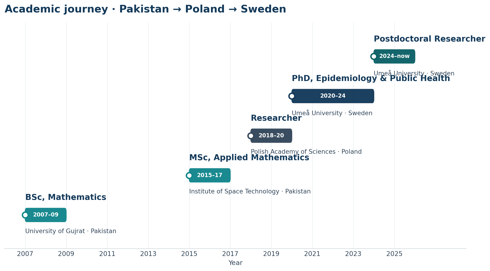

::: {#hero-heading}
:::

::: {.text-center}
[Research & Publications](ResearchProjects.qmd){.btn .btn-primary role="button"}
[Curriculum Vitae](Resume.qmd){.btn .btn-outline-primary role="button"}
[Google Scholar](https://scholar.google.com/citations?user=bz2GB_cAAAAJ&hl=en){.btn .btn-outline-primary role="button"}
:::

## Introduction

I am a data scientist and infectious-disease modeller at [Umeå University, Sweden](https://www.umu.se/en/staff/zia-farooq/), where I work as a postdoctoral researcher. My work brings together data science, machine learning, and mathematical modelling to understand and anticipate how infectious diseases spread in a changing climate.

Within the EU-funded IDAlert project, I use machine learning and explainable AI to predict outbreaks of complex zoonoses such as West Nile virus and to project their expansion under climate change. My recent first-author work in *The Lancet Planetary Health* traces the northward expansion of *Aedes albopictus* and the accelerating risk of dengue and chikungunya in Europe, while my latest study couples spatial-diffusion and time-to-event modelling to explain West Nile virus invasion across the continent. I also develop frameworks that separate the roles of climate change and human mobility in the global spread of dengue, and methods that sharpen disease-severity and case-fatality estimates. As a member of the [Lancet Countdown in Europe](https://www.lancetcountdown.org/) team, I develop the European risk indicator for West Nile virus.

## Academic journey

From mathematics in Pakistan to biological modelling in Poland and data-driven
epidemiology in Sweden — the path that shaped my research.

```{=html}
<figure class="figure-block">
  
  <figcaption>Academic and professional milestones, 2007–present.</figcaption>
</figure>
```

## Research Interests

My research interests and expertise include:

-   Predictive modelling of vector-borne and emerging infectious diseases
-   Machine learning, explainable AI, and mechanistic modelling
-   Spatial epidemiology, disease risk mapping, and ecological niche modelling
-   Climate change, human mobility, and the drivers of disease emergence
-   Survival and time-to-event analysis; disease-severity and case-fatality estimation
-   Epidemiological data science and reproducible research workflows

## Background

Before moving to Sweden in 2020, I spent around a year and a half in Warsaw, Poland, as a researcher at the Institute of Fundamental Technological Research, Polish Academy of Sciences. My earlier training in Pakistan was in mathematics and statistics, so relocating to Umeå marked both a geographical move and a deliberate shift in my research direction — from applied mathematics towards data-driven epidemiology.

Most of the code I wrote during my PhD was in R and MATLAB, and I remain a firmly data-oriented researcher: I routinely collect data through web scraping and APIs, adapt quickly to new tools, and occasionally work on text analysis. I speak English, Urdu, and Punjabi, and work fluently in R (dplyr and the tidyverse) and Python.

::: l-body-outset
<a href="https://github.com/Ziaf021">

::: calendar
Loading my github calendar data.
:::

</a>
:::

```{=html}
<script>
GitHubCalendar(".calendar", "Ziaf021", { responsive: true });
</script>
```
## Contact

```{r, echo = FALSE}
df <- data.frame(what = c('<i class="fab fa-twitter"></i>',
                          '<i class="fab fa-mastodon"></i>',
                           '<i class="fab fa-github"></i>',
                           '<i class="fas fa-envelope"></i>',
                           '<i class="fas fa-map-marker-alt"></i>'),
                 where = c("[DrFarooq_writes](https://x.com/DrFarooq_writes)",
                           '<a rel="me" href="https://fosstodon.org/@ziafarooq">ziafarooq@fosstodon.org</a>',
                           "[Ziaf021](https://github.com/Ziaf021)",
                           "[zia.farooq@umu.se](mailto:zia.farooq@umu.se)",
                           "<br> Department of Epidemiology and Global Health, <br>Umeå University,<br> Umeå 901 87,<br>Sweden"))
knitr::kable(df, col.names = c("", ""), escape = FALSE)

```

```{=html}
<iframe
  src="https://www.google.com/maps?q=Department+of+Epidemiology+and+Global+Health,+Ume%C3%A5+University&output=embed"
  width="100%" height="450" style="border:0;"
  allowfullscreen="" loading="lazy"
  referrerpolicy="no-referrer-when-downgrade"
  title="Map: Department of Epidemiology and Global Health, Umeå University">
</iframe>
```
