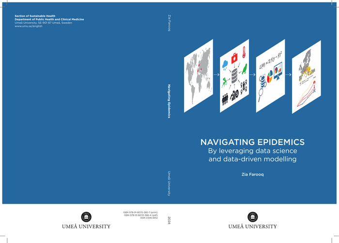

My research applies data science, machine learning, and mechanistic modelling to
predict the outbreak risk of infectious diseases, focusing on how climatic,
ecological, socioeconomic, and mobility factors shape disease emergence and
spread. Much of my recent work concerns the climate-driven expansion of
vector-borne diseases across Europe — West Nile virus, dengue, and chikungunya —
and the methods needed to forecast and monitor them.

::: {.text-center}
[Google Scholar](https://scholar.google.com/citations?user=bz2GB_cAAAAJ&hl=en){.btn .btn-primary role="button"}
[GitHub](https://github.com/Ziaf021){.btn .btn-outline-primary role="button"}
[DiVA repository](https://umu.diva-portal.org/smash/resultList.jsf?searchType=RESEARCH&query=&aq=%5B%5B%7B%22authorId%22%3A%22zifa0003%22%7D%5D%5D&language=en){.btn .btn-outline-primary role="button"}
[Curriculum Vitae](Resume.qmd){.btn .btn-outline-primary role="button"}
:::

## Featured first-author studies

```{=html}
<div class="pub-cards">

  <div class="pub-card">
    
    <div class="pub-top">The Lancet Planetary Health · 2025</div>
    <div class="pub-body">
      <div class="pub-title">Northward expansion of <em>Aedes albopictus</em>-associated arbovirus transmission risk in Europe</div>
      <div class="pub-meta">Quantifies the accelerating northward spread of the vector and the associated rise in arbovirus transmission risk across Europe.</div>
      <a class="pub-link" href="https://doi.org/10.1016/S2542-5196(25)00256-6">Read the paper →</a>
    </div>
  </div>

  <div class="pub-card">
    
    <div class="pub-top">The Lancet Planetary Health · 2025</div>
    <div class="pub-body">
      <div class="pub-title">Impact of climate and <em>Aedes albopictus</em> establishment on dengue and chikungunya outbreaks in Europe</div>
      <div class="pub-meta">A time-to-event analysis: the establishment-to-outbreak interval fell from 25 years to under 5 (1990–2024), with a near five-fold projected increase by the 2060s.</div>
      <a class="pub-link" href="https://doi.org/10.1016/S2542-5196(25)00059-2">Read the paper →</a>
    </div>
  </div>

  <div class="pub-card">
    
    <div class="pub-top">In revision · The Lancet Regional Health – Europe · 2026</div>
    <div class="pub-body">
      <div class="pub-title">Spatial diffusion and climatic suitability shape West Nile virus invasion risk across Europe</div>
      <div class="pub-meta">Couples a spatial-diffusion framework with time-to-event modelling across 18 European countries (2006–2024) to explain why some regions are invaded while eco-climatically similar neighbours are not.</div>
      <a class="pub-link" href="https://doi.org/10.21203/rs.3.rs-10383062/v1">Read the preprint →</a>
    </div>
  </div>

  <div class="pub-card">
    
    <div class="pub-top">Scientific Reports · 2025</div>
    <div class="pub-body">
      <div class="pub-title">Improving case fatality ratio estimates in ongoing pandemics through case-to-death time distribution analysis</div>
      <div class="pub-meta">A distributed-delay method that estimates the case fatality ratio from routine case and death time series, reducing bias in early-outbreak estimates.</div>
      <a class="pub-link" href="https://doi.org/10.1038/s41598-025-89441-y">Read the paper →</a>
    </div>
  </div>

  <div class="pub-card">
    
    <div class="pub-top">One Health · 2023</div>
    <div class="pub-body">
      <div class="pub-title">European projections of West Nile virus transmission under climate change scenarios</div>
      <div class="pub-meta">Projects shifts in the geographical spread of West Nile virus across Europe under future climate-change scenarios.</div>
      <a class="pub-link" href="https://doi.org/10.1016/j.onehlt.2023.100509">Read the paper →</a>
    </div>
  </div>

  <div class="pub-card">
    
    <div class="pub-top">The Lancet Regional Health – Europe · 2022</div>
    <div class="pub-body">
      <div class="pub-title">Artificial intelligence to predict West Nile virus outbreaks with eco-climatic drivers</div>
      <div class="pub-meta">A machine-learning model integrating environmental and climatic variables to forecast West Nile virus transmission risk.</div>
      <a class="pub-link" href="https://doi.org/10.1016/j.lanepe.2022.100370">Read the paper →</a>
    </div>
  </div>

  <div class="pub-card">
    <div class="pub-top inprep">In preparation · 2026</div>
    <div class="pub-body">
      <span class="badge-inprep">To be submitted</span>
      <div class="pub-title">Human mobility and climate change are escalating the transcontinental threat of dengue</div>
      <div class="pub-meta">Couples global human-mobility networks with climatic suitability to assess the transcontinental spread of dengue from endemic to non-endemic regions.</div>
    </div>
  </div>

</div>
```

## Peer-reviewed publications

1. **The 2026 Europe report of the Lancet Countdown on health and climate change:
   narrowing window for decisive health action.**
   *The Lancet Public Health*, 11(6):e386–e407, 2026. Contributing author.
   [Record on DiVA](https://umu.diva-portal.org/smash/record.jsf?pid=diva2:2074827&language=en)

2. **Northward expansion of *Aedes albopictus*-associated arbovirus transmission
   risk in Europe.** *The Lancet Planetary Health*, 9(12):101378, 2025.
   First author (Farooq, Rocklöv, Semenza). Characterises the accelerating
   northward spread of *Aedes albopictus* and the associated expansion of
   arbovirus transmission risk.
   [DOI: 10.1016/S2542-5196(25)00256-6](https://doi.org/10.1016/S2542-5196(25)00256-6)

3. **Impact of climate and *Aedes albopictus* establishment on dengue and
   chikungunya outbreaks in Europe: a time-to-event analysis.**
   *The Lancet Planetary Health*, 9(5):e374–e383, 2025. First author.
   A time-to-event analysis showing that the interval from vector establishment
   to first outbreak fell from 25 years to under 5 years (1990–2024), with a
   projected near five-fold increase in outbreaks by the 2060s under SSP5–8.5.
   [DOI: 10.1016/S2542-5196(25)00059-2](https://doi.org/10.1016/S2542-5196(25)00059-2)
   · [Code on GitHub](https://github.com/Ziaf021/Time2Event)

4. **Improving case fatality ratio estimates in ongoing pandemics through
   case-to-death time distribution analysis.** *Scientific Reports*, 15:5402, 2025.
   First author. A distributed-delay method that estimates the case fatality
   ratio from routine case and death time series, reducing bias in early-outbreak
   estimates.
   [DOI: 10.1038/s41598-025-89441-y](https://doi.org/10.1038/s41598-025-89441-y)

5. **Input precision, output excellence: the importance of data quality control
   and method selection in disease risk mapping — authors' reply.**
   *The Lancet Regional Health – Europe*, 42:100947, 2024.
   [DOI: 10.1016/j.lanepe.2024.100947](https://doi.org/10.1016/j.lanepe.2024.100947)

6. **The 2024 Europe report of the Lancet Countdown on health and climate change:
   unprecedented warming demands unprecedented action.**
   *The Lancet Public Health*, 9(7):e495–e522, 2024. Contributing author.
   [DOI: 10.1016/S2468-2667(24)00055-0](https://doi.org/10.1016/S2468-2667(24)00055-0)

7. **European projections of West Nile virus transmission under climate change
   scenarios.** *One Health*, 16:100509, 2023. First author.
   [DOI: 10.1016/j.onehlt.2023.100509](https://doi.org/10.1016/j.onehlt.2023.100509)
   · [Lancet Countdown WNV indicator code](https://github.com/Ziaf021/LancetEurope_WNV)

8. **Decision-support tools to build climate resilience against emerging
   infectious diseases in Europe and beyond.**
   *The Lancet Regional Health – Europe*, 32:100701, 2023.
   [DOI: 10.1016/j.lanepe.2023.100701](https://doi.org/10.1016/j.lanepe.2023.100701)

9. **Artificial intelligence to predict West Nile virus outbreaks with
   eco-climatic drivers.**
   *The Lancet Regional Health – Europe*, 17:100370, 2022. First author.
   [DOI: 10.1016/j.lanepe.2022.100370](https://doi.org/10.1016/j.lanepe.2022.100370)
   · [Code on GitHub](https://github.com/Ziaf021/WNV_drivers_study)

10. **The 2022 Europe report of the Lancet Countdown on health and climate change:
    towards a climate resilient future.**
    *The Lancet Public Health*, 7(11):e942–e965, 2022. Contributing author.
    [DOI: 10.1016/S2468-2667(22)00197-9](https://doi.org/10.1016/S2468-2667(22)00197-9)

11. **COVID-19 healthcare demand and mortality in Sweden in response to
    non-pharmaceutical mitigation and suppression scenarios.**
    *International Journal of Epidemiology*, 49(5):1443–1453, 2020.
    [DOI: 10.1093/ije/dyaa126](https://doi.org/10.1093/ije/dyaa126)

12. **Only strict quarantine measures can curb the coronavirus disease (COVID-19)
    outbreak in Italy, 2020.** *Eurosurveillance*, 25(13):2000280, 2020.
    [DOI: 10.2807/1560-7917.ES.2020.25.13.2000280](https://doi.org/10.2807/1560-7917.ES.2020.25.13.2000280)

13. **Information processing in unregulated and autoregulated gene expression.**
    *2020 European Control Conference (ECC)*, 258–263, 2020.
    [DOI: 10.23919/ECC51009.2020.9143952](https://doi.org/10.23919/ECC51009.2020.9143952)

14. **Bifurcation analysis of heartbeat model.**
    *Journal of Space Technology*, 2017. First author.

## PhD thesis

**Navigating epidemics by leveraging data science and data-driven modelling.**
Umeå University Medical Dissertations 2305, 2024.
[Record on DiVA](https://umu.diva-portal.org/smash/record.jsf?pid=diva2:1855639&language=en)

```{=html}
<figure class="figure-block">
  
  <figcaption>Thesis cover — <em>Navigating Epidemics: by leveraging data science and data-driven modelling</em>, Umeå University, 2024.</figcaption>
</figure>
```

My public defence (disputation) was held on **03 June 2024** at Umeå University, and
the doctoral degree was conferred at the graduation ceremony on **17 May 2025**.

```{=html}
<div class="pub-cards">
  <div class="pub-card">
    
    <div class="pub-top">Public defence · 03 June 2024</div>
  </div>
  <div class="pub-card">
    
    <div class="pub-top">Doctoral graduation ceremony · 17 May 2025</div>
  </div>
</div>
```

## Manuscripts under review & in preparation

- **Human mobility and climate change are escalating the transcontinental threat
  of dengue.** First author (Farooq, Semenza, Rocklöv, Singh, Sjödin) — to be
  submitted, 2026. Couples global human-mobility networks with climatic
  suitability to assess the spread of dengue from endemic to non-endemic regions.

- **Comparing machine learning and process-based projections of West Nile virus
  transmission suitability under climate change scenarios in Europe.**
  Heidecke, Kriit, **Farooq**, Dafka, Rocklöv — under review, *PLOS Computational
  Biology*, 2026.

- **The 2027 Europe report of the Lancet Countdown on health and climate change.**
  Contributing author — forthcoming, 2027.

- **Climate change attribution and projections of infectious diseases.**
  Co-author — forthcoming, 2027.

- **Socioeconomic vulnerability shapes the spatiotemporal distribution of malaria
  risk in Punjab, Pakistan.** Asif M, Semenza JC, **Farooq Z** — senior author,
  supervising the first-author PhD student; submitted, 2026.

## Selected code repositories

- [**WNV_drivers_study**](https://github.com/Ziaf021/WNV_drivers_study) — machine
  learning to identify eco-climatic drivers of West Nile virus outbreaks (R).
- [**LancetEurope_WNV**](https://github.com/Ziaf021/LancetEurope_WNV) — scripts
  reproducing the Lancet Countdown Europe West Nile virus indicator.
- [**Time2Event**](https://github.com/Ziaf021/Time2Event) — time-to-event analysis
  of dengue and chikungunya outbreaks in Europe.
- [**matlab-optimisation**](https://github.com/Ziaf021/matlab-optimisation) — ODE
  parameter optimisation using parallel and multistart methods.
