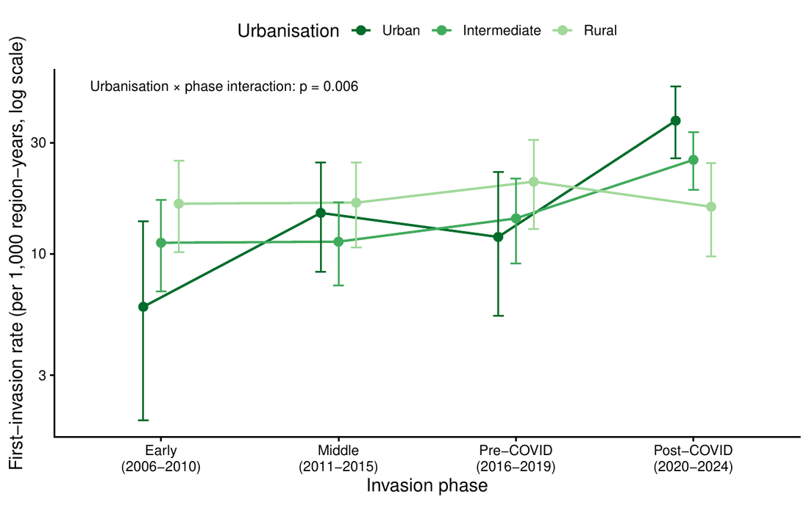

West Nile virus lives mostly in birds. Mosquitoes carry it between them, and now and then to people or horses. We are a dead end for it, since we do not pass it on, but it can still cause serious illness, including meningitis and encephalitis. In Europe the usual carrier is the Culex mosquito, which breeds in still water and grows more active in warm weather. Hot summers, the timing of bird migration, and the right wet habitat shape where it appears. For years it was mainly a rural problem, around farmland and wetlands, though it has lately been reaching fresh regions and pushing north.

Cities are not off-limits to it. When the virus first reached the United States it surfaced in New York in 1999, spread by a city-dwelling Culex that breeds in drains and gutters. So it is fair to ask whether Europe is drifting the same way.

We sorted the regions where the virus caused its first human cases into three kinds, following a standard European scheme: urban, semi-urban, and rural. Then we followed how the pattern changed over four periods from 2006 to 2024.

The make-up of newly affected regions changed over time. Early on, rural and semi-urban regions dominated and urban regions were a small slice. By 2020–2024, urban and semi-urban regions together made up most of the new invasions, and the rural share had shrunk.

A raw share can mislead, because once a region is affected it leaves the pool still open to invasion. So we also measured a fair rate: first invasions per year among the regions of each kind still at risk.

The fair rate tells the sharper story. In 2006–2010, rural regions had the highest first-invasion rate and urban the lowest. By 2020–2024 the order had flipped, with urban highest and rural about where it began. Semi-urban regions rose alongside urban. The shift is statistically clear, and it holds after correcting for the shrinking pool.

Two things temper it. The change sits entirely in the last five-year window; from 2007 to 2019 the three kinds of region were reached at steady rates. And those recent years overlap the COVID-19 pandemic, when testing and surveillance were disrupted and, in many places, concentrated in cities.

It is worth being clear about what that second point does and does not undo. If testing had simply increased everywhere after the pandemic, it would lift the numbers across the board without tilting them toward cities. For the balance to move toward urban and semi-urban regions, either the virus is genuinely reaching them more, or we are now detecting there what we used to miss. Both fit these data. Either way, that is where the confirmed cases now sit, and that is where preparedness has to follow.

So the honest answer to the question in the title is a qualified yes. West Nile virus is turning up more in urban and semi-urban Europe in recent years, whether because it is truly moving in or because we are watching cities more closely. The response is the same in both cases: steady, well-resourced surveillance in towns and cities, so a real move toward dense populations is caught early rather than argued about after the fact.

[Read the preprint](https://doi.org/10.21203/rs.3.rs-10383062/v1)
