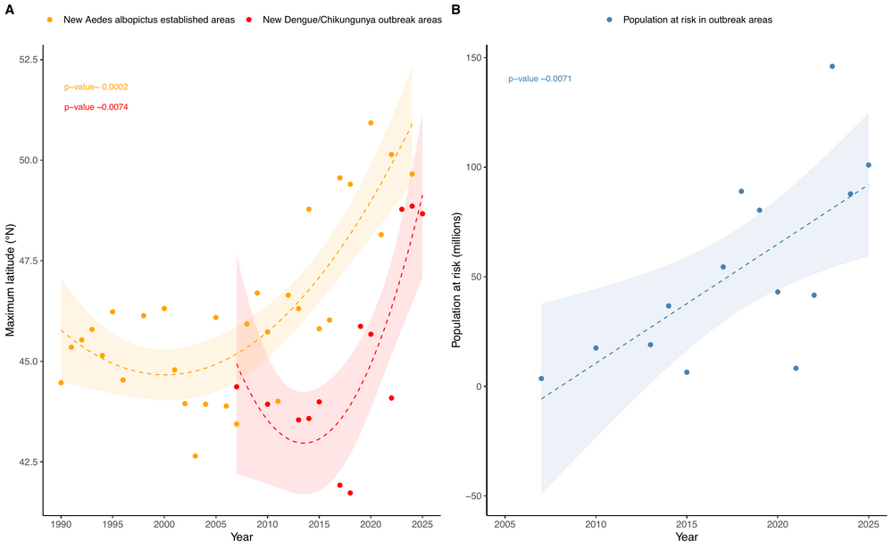
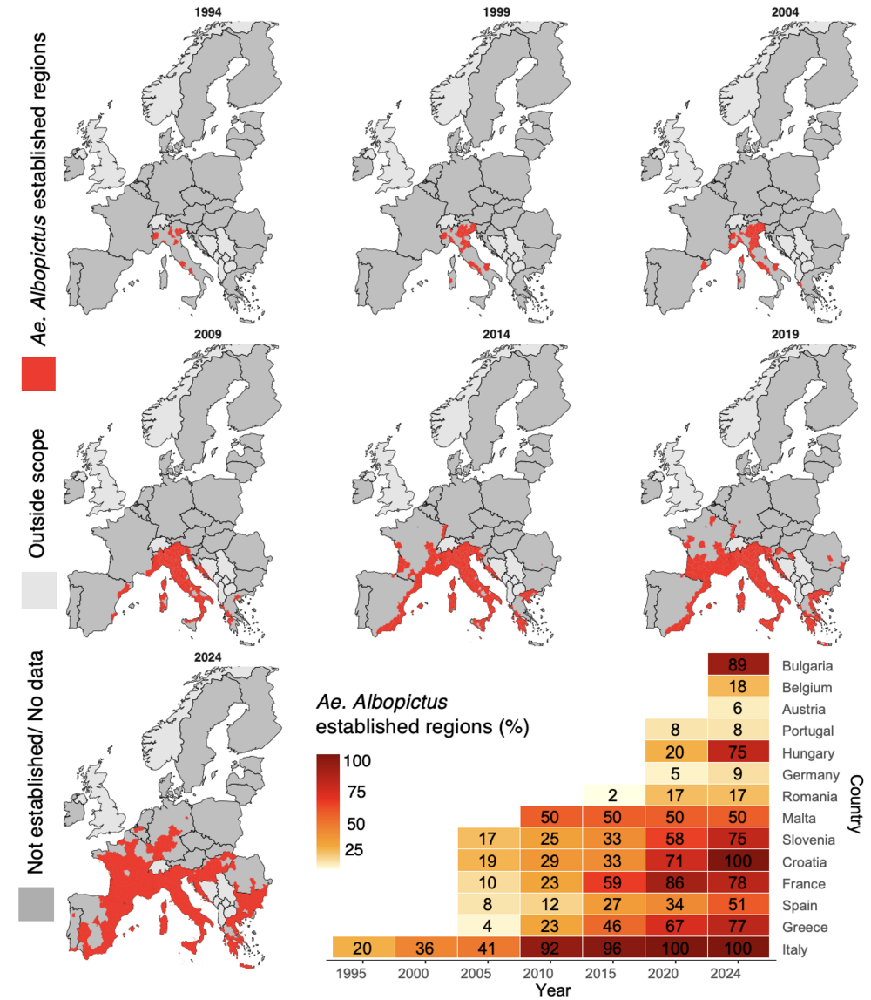
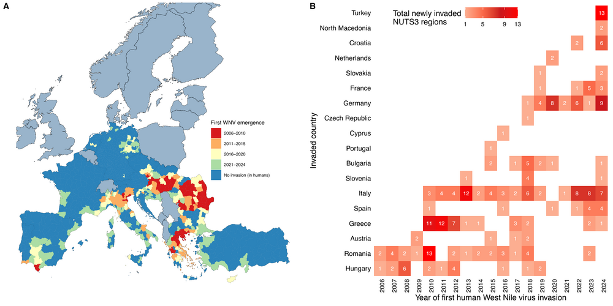
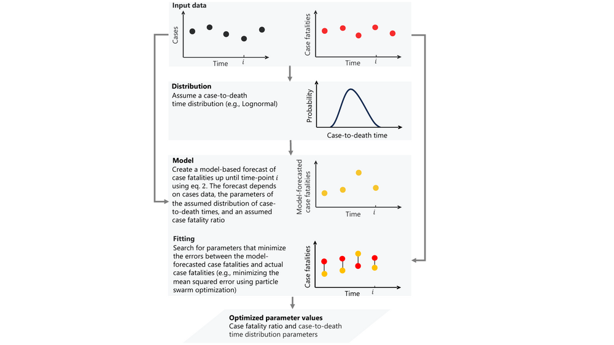
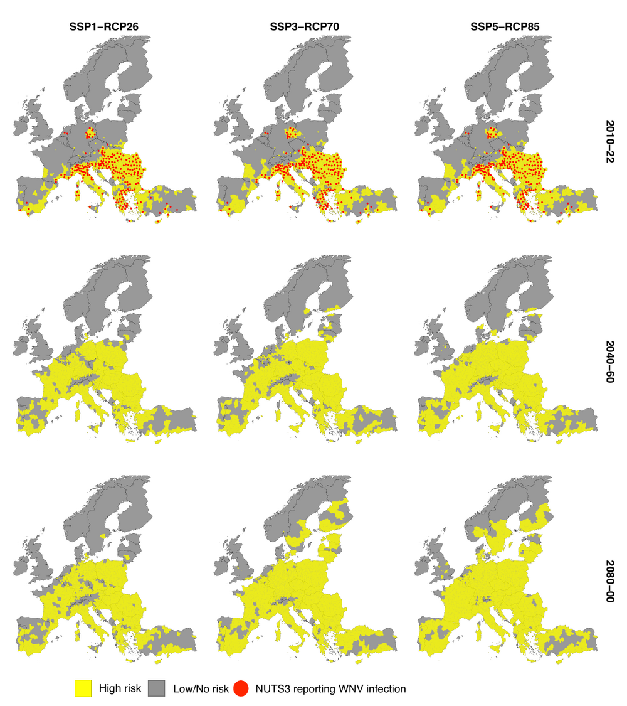
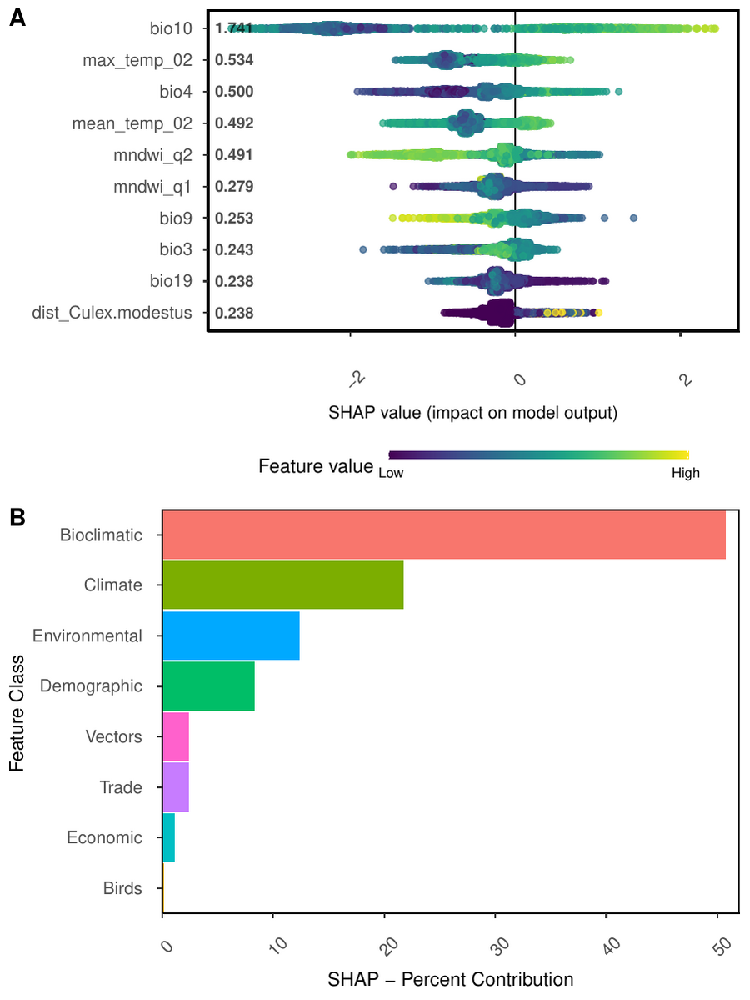
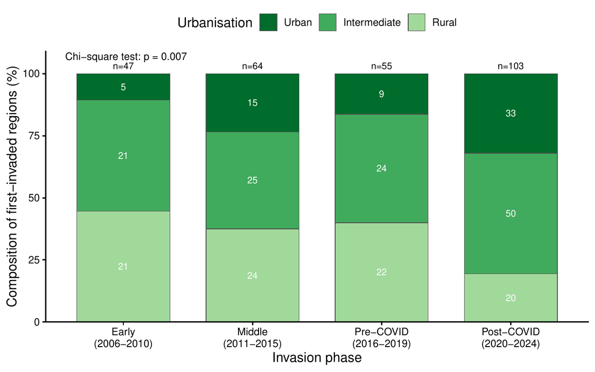

::: home-section
## Words that inspire me

```{=html}
<div class="quotes">
  <div class="quote"><div class="q-text">If the path before you is clear, you're probably on someone else's.</div><div class="q-author">— Carl Jung</div></div>
  <div class="quote"><div class="q-text">Somewhere, something incredible is waiting to be known.</div><div class="q-author">— Carl Sagan</div></div>
  <div class="quote"><div class="q-text">If I have seen further it is by standing on the shoulders of giants.</div><div class="q-author">— Isaac Newton</div></div>
  <div class="quote"><div class="q-text">The important thing is not to stop questioning. Curiosity has its own reason for existing.</div><div class="q-author">— Albert Einstein</div></div>
</div>
```
:::

::: home-section
## Welcome

I am a postdoctoral researcher at Umeå University, Sweden, working where data
science, machine learning, and infectious-disease epidemiology meet. I build
spatio-temporal and mechanistic models that forecast the outbreak and expansion
risk of climate-sensitive diseases — West Nile virus, dengue, and chikungunya —
from the interplay of climatic, ecological, socioeconomic, and human-mobility
drivers.

I develop the European West Nile virus risk indicator for the Lancet Countdown in
Europe and contribute to the EU-funded IDAlert project, pairing explainable AI
with mechanistic modelling to turn complex data into evidence for
climate-resilient public health.

[Research & Publications](ResearchProjects.qmd){.btn .btn-primary role="button"}
[About Me](About_Zia.qmd){.btn .btn-outline-primary role="button"}
[Curriculum Vitae](Resume.qmd){.btn .btn-outline-primary role="button"}
:::

::: home-section
## At a glance

```{=html}
<div class="metrics">
  <div class="metric"><span class="num">2,146</span><span class="label">Citations (Google Scholar)</span></div>
  <div class="metric"><span class="num">11</span><span class="label">h-index</span></div>
  <div class="metric"><span class="num">12</span><span class="label">i10-index</span></div>
  <div class="metric"><span class="num">18</span><span class="label">Publications</span></div>
  <div class="metric"><span class="num">9</span><span class="label">First-author papers</span></div>
  <div class="metric"><span class="num">4</span><span class="label">Grants &amp; awards secured</span></div>
</div>
```
:::

::: home-section
## Featured research

```{=html}
<div class="pub-cards">

  <div class="pub-card">
    
    <div class="pub-top">The Lancet Planetary Health · 2025</div>
    <div class="pub-body">
      <div class="pub-title">Northward expansion of <em>Aedes albopictus</em>-associated arbovirus transmission risk in Europe</div>
      <div class="pub-meta">First author. Quantifies the accelerating northward spread of the vector and the associated rise in arbovirus transmission risk.</div>
      <a class="pub-link" href="https://doi.org/10.1016/S2542-5196(25)00256-6">Read the paper →</a>
    </div>
  </div>

  <div class="pub-card">
    
    <div class="pub-top">The Lancet Planetary Health · 2025</div>
    <div class="pub-body">
      <div class="pub-title">Impact of climate and <em>Aedes albopictus</em> establishment on dengue and chikungunya outbreaks in Europe</div>
      <div class="pub-meta">First author. A time-to-event analysis: the interval from vector establishment to first outbreak fell from 25 years to under 5 (1990–2024).</div>
      <a class="pub-link" href="https://doi.org/10.1016/S2542-5196(25)00059-2">Read the paper →</a>
    </div>
  </div>

  <div class="pub-card">
    
    <div class="pub-top">In revision · The Lancet Regional Health – Europe · 2026</div>
    <div class="pub-body">
      <div class="pub-title">Spatial diffusion and climatic suitability shape West Nile virus invasion risk across Europe</div>
      <div class="pub-meta">First author. Couples a spatial-diffusion framework with time-to-event modelling across 18 European countries (2006–2024).</div>
      <a class="pub-link" href="https://doi.org/10.21203/rs.3.rs-10383062/v1">Read the preprint →</a>
    </div>
  </div>

  <div class="pub-card">
    
    <div class="pub-top">Scientific Reports · 2025</div>
    <div class="pub-body">
      <div class="pub-title">Improving case fatality ratio estimates in ongoing pandemics through case-to-death time distribution analysis</div>
      <div class="pub-meta">First author. A distributed-delay method that estimates the case fatality ratio from routine case and death time series, reducing bias in early-outbreak estimates.</div>
      <a class="pub-link" href="https://doi.org/10.1038/s41598-025-89441-y">Read the paper →</a>
    </div>
  </div>

  <div class="pub-card">
    
    <div class="pub-top">One Health · 2023</div>
    <div class="pub-body">
      <div class="pub-title">European projections of West Nile virus transmission under climate change scenarios</div>
      <div class="pub-meta">First author. Projects shifts in the geographical spread of West Nile virus across Europe under climate-change scenarios.</div>
      <a class="pub-link" href="https://doi.org/10.1016/j.onehlt.2023.100509">Read the paper →</a>
    </div>
  </div>

  <div class="pub-card">
    
    <div class="pub-top">The Lancet Regional Health – Europe · 2022</div>
    <div class="pub-body">
      <div class="pub-title">Artificial intelligence to predict West Nile virus outbreaks with eco-climatic drivers</div>
      <div class="pub-meta">First author. A machine-learning model integrating environmental and climatic variables to forecast WNV transmission risk.</div>
      <a class="pub-link" href="https://doi.org/10.1016/j.lanepe.2022.100370">Read the paper →</a>
    </div>
  </div>

</div>
```

[See all publications](ResearchProjects.qmd){.btn .btn-outline-primary role="button"}
:::

::: home-section
## Published in

```{=html}
<div class="journals">
  <span class="jrnl">The Lancet Planetary Health <b>(2)</b></span>
  <span class="jrnl">The Lancet Public Health <b>(3)</b></span>
  <span class="jrnl">The Lancet Regional Health – Europe <b>(3)</b></span>
  <span class="jrnl">Scientific Reports <b>(1)</b></span>
  <span class="jrnl">One Health <b>(1)</b></span>
  <span class="jrnl">International Journal of Epidemiology <b>(1)</b></span>
  <span class="jrnl">Eurosurveillance <b>(1)</b></span>
  <span class="jrnl">European Control Conference (IEEE) <b>(1)</b></span>
  <span class="jrnl">Journal of Space Technology <b>(1)</b></span>
</div>
```
:::

::: home-section
## From the blog

```{=html}
<div class="pub-cards">
  <div class="pub-card">
    <a href="blog/posts/wnv-urban/"></a>
    <div class="pub-top">Blog · 2026</div>
    <div class="pub-body">
      <div class="pub-title">Is West Nile virus moving towards urban Europe?</div>
      <div class="pub-meta">A once-rural virus is turning up more in Europe's urban and semi-urban regions. What the data show, and what they can't yet settle.</div>
      <a class="pub-link" href="blog/posts/wnv-urban/">Read the post →</a>
    </div>
  </div>
</div>
```

[Visit the blog](blog/index.qmd){.btn .btn-outline-primary role="button"}
:::

::: home-section
## Funding & awards secured

```{=html}
<div class="funding">
  <div class="fund-item">
    <div class="fund-name">Kempe Foundation Postdoctoral Scholarship</div>
    <div class="fund-detail">Two-year competitive fellowship · 2026–2028</div>
  </div>
  <div class="fund-item">
    <div class="fund-name">MIRAI Japan–Sweden Mobility Grant</div>
    <div class="fund-detail">Long-term mobility grant for Early-Career Researchers · SEK 130,000</div>
  </div>
  <div class="fund-item">
    <div class="fund-name">Medical Faculty Internationalization Grant</div>
    <div class="fund-detail">Umeå University · SEK 28,500</div>
  </div>
  <div class="fund-item">
    <div class="fund-name">Research Visit Travel Grant</div>
    <div class="fund-detail">Awarded during PhD · SEK 18,500</div>
  </div>
</div>
```

### Applications under review

```{=html}
<div class="funding">
  <div class="fund-item pending">
    <div class="fund-name">FORTE — abortion research project</div>
    <div class="fund-detail">Under review · decision expected late 2026</div>
  </div>
</div>
```
:::

::: home-section
## Recent highlights

```{=html}
<div class="timeline">
  <div class="t-item"><span class="t-year">2026</span><span class="t-text">Spatial-diffusion study of West Nile virus invasion across Europe in revision at <em>The Lancet Regional Health – Europe</em>.</span></div>
  <div class="t-item"><span class="t-year">2026</span><span class="t-text">New blog post: <a href="blog/posts/wnv-urban/">Is West Nile virus moving towards urban Europe?</a></span></div>
  <div class="t-item"><span class="t-year">2026</span><span class="t-text">Submitted a study on socioeconomic vulnerability and malaria risk in Punjab, Pakistan (senior author).</span></div>
  <div class="t-item"><span class="t-year">2026</span><span class="t-text">Contributing author to the 2026 Europe report of the Lancet Countdown (<em>The Lancet Public Health</em>).</span></div>
  <div class="t-item"><span class="t-year">2025</span><span class="t-text">Published two first-author papers in <em>The Lancet Planetary Health</em> on the expansion of <em>Aedes albopictus</em> and arboviral outbreaks in Europe.</span></div>
  <div class="t-item"><span class="t-year">2025</span><span class="t-text">Research visit to the Applied Ecology Unit, Fondazione Edmund Mach, Trento, Italy.</span></div>
  <div class="t-item"><span class="t-year">2025</span><span class="t-text">Awarded the MIRAI Japan–Sweden long-term mobility grant for early-career researchers.</span></div>
  <div class="t-item"><span class="t-year">2024</span><span class="t-text">Completed PhD in Epidemiology and Public Health at Umeå University.</span></div>
</div>
```
:::

::: home-section
## Research focus

- **Predictive modelling of vector-borne diseases** — machine learning,
  explainable AI, and mechanistic models forecasting outbreak and expansion risk
  for West Nile virus, dengue, and chikungunya.
- **Climate change and disease ecology** — attributing the roles of climate,
  environment, and human mobility in the emergence and northward spread of
  arboviruses across Europe.
- **Spatial epidemiology** — disease risk mapping, ecological niche and
  species-distribution modelling, and spatial-diffusion frameworks for disease
  invasion.
- **Biostatistics & methods** — survival and time-to-event analysis, case-fatality
  and disease-severity estimation, and reproducible, data-driven workflows.
- **Indicators for policy** — European early-warning indicators for the Lancet
  Countdown and decision-support tools for climate-resilient health systems.
:::
